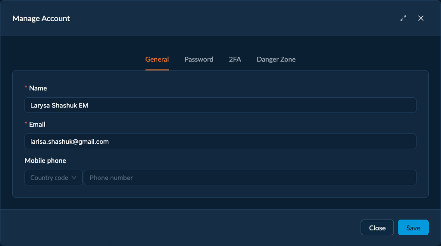
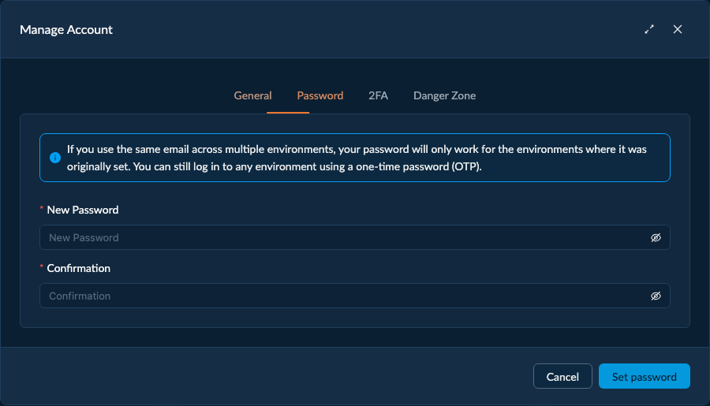
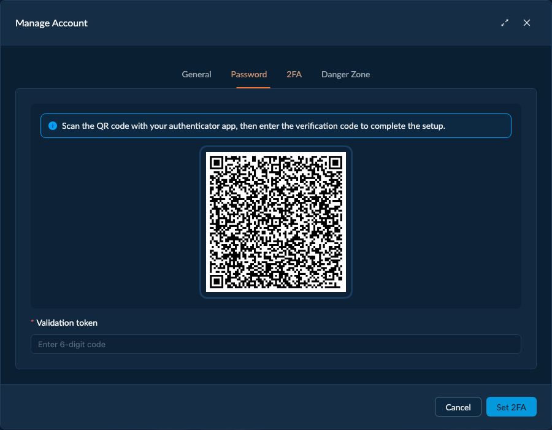
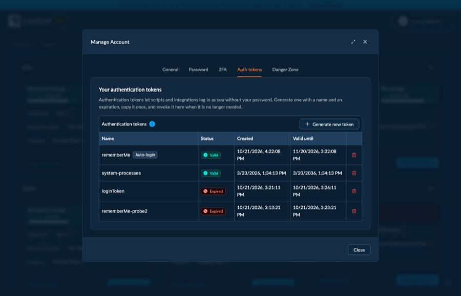
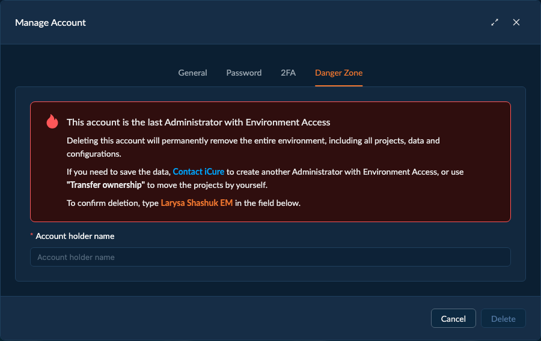

# Manage Account

**Manage Account** (the account dropdown in the header) is where you manage **your own** administrator
account — profile, credentials, and account deletion. It's about *you*, the signed-in admin, not the
project's users. The modal has five tabs.

## General

Edit your account details — your **email** and **mobile phone**. Changes are saved per field.

## Password

**Set password** (or change it); minimum **10 characters**.

:::info
**Passwords are per-environment.** *"If you use the same email across multiple environments, your password
will only work for the environments where it was originally set. You can still log in to any environment
using a one-time password (OTP)."* See [Authentication](/cockpit/authentication).
:::

## 2FA

Add two-factor authentication with an authenticator app: **scan the QR code with your authenticator app,
then enter the verification code** (a 6-digit token) to complete setup. Once enabled you can **Disable 2FA**
again (with confirmation). The 2FA tab appears once you have a password set.

## Auth tokens

Your own **authentication tokens** — the long-lived credentials scripts and integrations use to log in **as
you** without your password. Until now they were only visible to other administrators in the
[Administrators](/cockpit/administrators) table; this tab lists them for your own account, with each
token's **Status**, **Created** and **Valid until** dates.

- **Generate new token** takes a **Token name** and an **Expiration date and time** (at least 5 minutes
  from now). The value is **shown only once**, so copy it immediately.
- **Revoke** (the bin icon, with confirmation) invalidates a token immediately. Expired and revoked tokens
  stay listed for a week, marked **Expired**.
- The token tagged **Auto-login** is the one Cockpit created when you logged in: it keeps you signed in on
  this browser between visits. Revoking it signs you out on the next reload; the tab you are in keeps
  working until then.

:::caution
A token logs in to your account with **the same rights you have**, so treat it like a password. Revoke any
token you no longer need, and any token you suspect has leaked.
:::

:::info
Generating a token is a **sensitive action**: Cockpit may ask for a fresh one-time code (or your 2FA /
password) before the token is created. See [Security](/cockpit/security).
:::

## Danger Zone

**Delete** your account.

:::danger
If you're the **last administrator with Environment Access**, deleting your account **permanently removes
the entire [Environment](/cockpit/environment)** — all projects, tenants, data, and configuration. Cockpit warns you and points
to safer options: contact iCure to add another Environment-Access admin, or use **[Transfer ownership](/cockpit/transfer-ownership)**
to move your projects first. See [Administrators & Access Levels](/cockpit/administrators-and-access-levels).
:::

## Where to go next

- **[Manage Environment](/cockpit/manage-environment)** — the environment-wide settings (vs. your personal account here).
- **[Switch Environment](/cockpit/switch-environment)** — moving between environments your email can access.
- **[Authentication](/cockpit/authentication)** — login methods, 2FA, and tokens in context.
- **[Administrators](/cockpit/administrators)** — the tokens of *other* administrators are managed from their row there.
