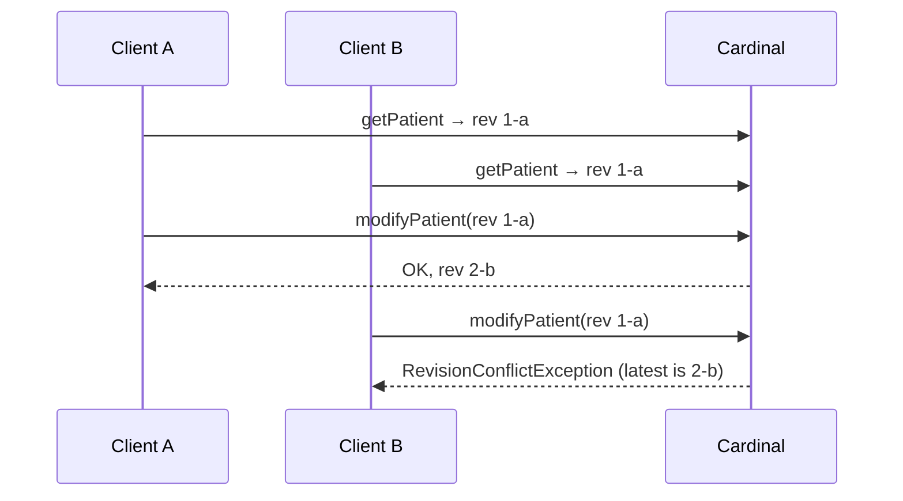
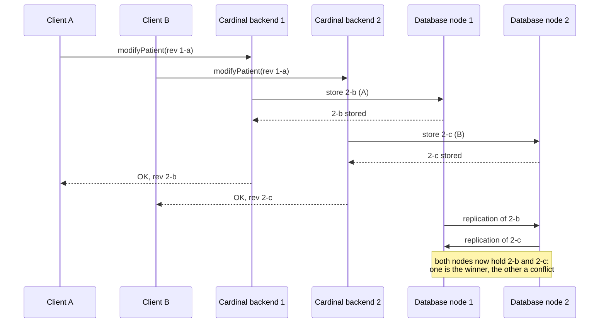

# Concurrent modifications and conflicts

Cardinal stores its data in a database that is replicated over several nodes. This page explains what happens when
two clients modify the same entity at the same time, why both modifications can be accepted, and how the extra
modifications are kept as conflicts instead of being lost.

## Revisions and optimistic concurrency

Every stored entity has a revision (`rev`), for example `2-6d4d21f98e3b9c967b9bc29565209ea0`. The number before the
dash counts the modifications of the entity, and the rest identifies the content of that revision. Each successful
modification returns the entity with a new revision.

To modify an entity you send it with the revision you read. If the backend already knows a more recent revision, it
refuses the modification and the SDK throws a `RevisionConflictException`. This is optimistic concurrency: nothing is
locked while a user edits an entity, and a modification based on outdated data is refused instead of silently
overwriting a more recent one. [Updating entities](/how-to/basic-operations#updating-entities) shows how to handle this
exception.

In the usual case, when one modification happens after the other, the second one is refused:

## Why two modifications of the same revision can both succeed

The revision check is not a lock. In production, the Cardinal backend stores its data in a database cluster: every
entity is stored as several copies, on different database nodes. The database nodes replicate their changes to each
other continuously, but not instantly, so the database is _eventually consistent_.

When two modifications of the same revision arrive at about the same time (typically within a few milliseconds), the
backend passes both of them on to the database, because neither is outdated compared to the revision it knows. In the
database, each copy of the entity stores the first of the two modifications that reaches it. If the modifications
reach the copies in a different order, both are stored, each on some of the copies, and both clients receive a success
with a different new revision.

The conflict is created afterwards, in the database itself: when the database nodes replicate their changes to each
other, each copy receives the modification it didn't store. Since both modifications derive from the same revision, the
database keeps both of them as revisions of the entity:

This is expected behaviour, not an error. A single-node database never behaves this way: there, the second
modification is always refused. The more clients write the same entity at the same moment, the more likely it is; in
our tests with 4 clients writing the same entity simultaneously on a 5-node cluster, 2 to 4 of the modifications were
regularly accepted.

## Nothing is lost: conflicts

When the database nodes replicate their changes, the database does not discard any of the accepted modifications. All of them
are kept as revisions of the entity:

- One of them is the **winner**. The choice is deterministic, so every node picks the same one, but it is arbitrary
  from your application's point of view: it is not necessarily the modification that arrived last.
- The others are **conflicts**. They are kept next to the winner until they are resolved.

Reading the entity returns the winner. As a consequence, a client whose modification was accepted can read the entity
right afterwards and not find its change in it: the change is in a conflicting revision.

Conflicts appear progressively, not at the moment of the writes. A read only consults some of the copies of the
entity in the database, so just after the writes it may return the winner without showing the conflicts yet. They
become visible once the database nodes have replicated their changes, usually within a few seconds.

## Resolving conflicts

Conflicts can be resolved by merging the conflicting revisions into the winner. The merge works field by field and only
combines revisions that don't contradict each other: a field set in only one of them, a set or a map to which each
added different elements, a list that one of them extended. If two revisions changed the same field to different
values, merging could lose data, so that revision is left as a conflict.

For example, if one client adds a property to a patient while another one changes its note, the two revisions are
merged into one that has both changes. If both clients changed the note, the conflict remains.

The SDK exposes this resolution as maintenance operations:

- `sdk.group.solveConflicts(groupId, limit, warmup)` resolves the conflicts of a group, for codes, contacts, documents,
  forms, health elements, invoices, messages, patients and users. It returns the id and new revision of each entity it
  merged.
- `sdk.system.resolvePatientsConflicts(limit)`, `resolveContactsConflicts`, `resolveFormsConflicts`,
  `resolveHealthElementsConflicts`, `resolveInvoicesConflicts`, `resolveMessagesConflicts` and
  `resolveDocumentsConflicts` do the same for one entity type in the current group.

These operations require the `AutoResolveConflicts` system maintenance permission. They are meant to be run
periodically or after a burst of concurrent activity, not after every modification.

## Designing for concurrent modifications

- **Keep handling `RevisionConflictException`.** It is still what you get in most concurrent cases, and the
  [retry pattern](/how-to/basic-operations#updating-entities) remains the right answer to it.
- **Don't use the revision check as a lock.** A success doesn't guarantee that your modification is the one readers
  will see, so don't build a mutual exclusion (a counter, a reservation, a "first one wins" rule) on the fact that a
  concurrent modification of the same revision fails.
- **Avoid having many clients modify the same entity at the same time.** Prefer modifying separate entities, for
  example one entity per user or per event, rather than a shared entity that everyone updates.
- **Don't expect a read just after a write to show every change.** If several clients wrote the same entity at the same
  time, the read returns the winner only, and the conflicts show up over the following seconds.
- **Resolve conflicts regularly** if your application lets several users edit the same entities, using the operations
  listed above.
